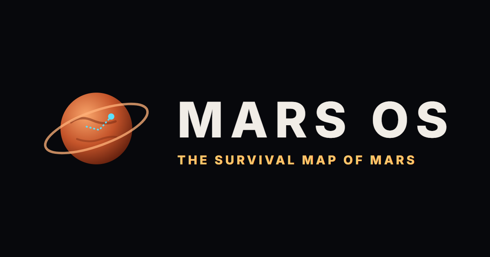
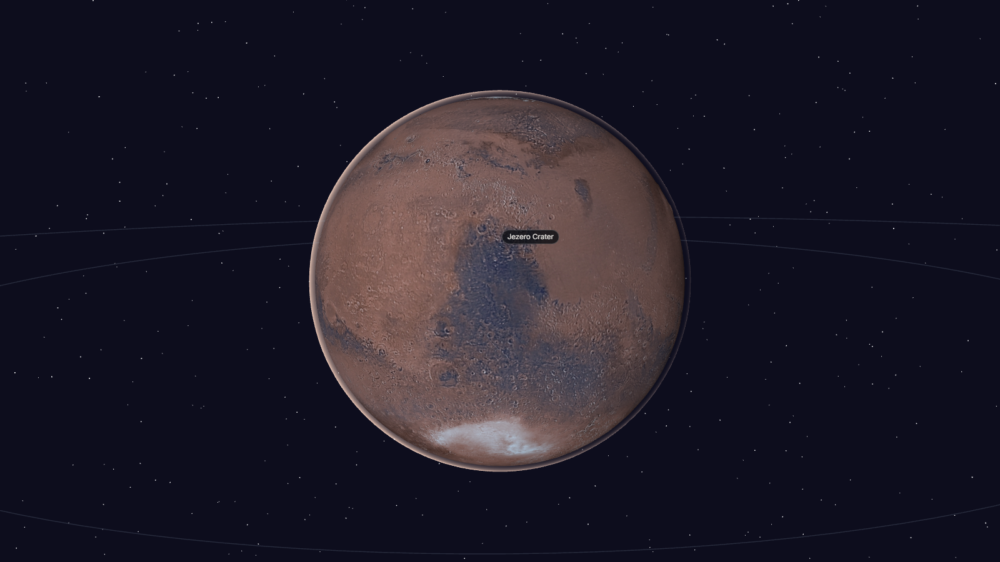

<p align="center"></p>

# MARS OS — the survival map of Mars, built on NASA data

**NASA Space Apps Challenge 2026 · Challenge: _Interplanetary Survival Guide: Martian Map_**
**Team MARS OS:** Abril Miranda Villa Márquez (team owner) · Jorge Emilio Cornejo Murra

| | |
|---|---|
| **Live app (no login)** | https://abrilvilla.dev/mars-os/ |
| **Demo deck (7 slides)** | https://abrilvilla.dev/mars-os/deck/ |
| **Backend status** | https://mars-os-api.onrender.com/api/health (free tier: the first request after idle can take about a minute) |



MARS OS is a living 3D atlas of Mars that answers the questions a survival guide must answer, with data from more than 20 NASA missions and datasets. You can fly from orbit to boot level, and every number on screen tells you where it comes from.

## What it answers

| Question | Where in the app | Data |
|---|---|---|
| **Where can we land?** | **Landing** tab: how sites are chosen, real landing ellipses, NASA's 51 Exploration Zones for human missions, a landing check for any point | MOLA, Mars Trek EZ and ellipse services |
| **Where is the water? What resources are there?** | Left panel → **Resources**: craters that exposed ice, buried glaciers, mineral detections, Perseverance's 30 named samples | Mars Trek (Dundas et al. 2014; GLF survey; Ehlmann & Edwards 2014; Carter et al. 2013), Mars 2020 samples table |
| **What is dangerous?** | **Routes** → risk analysis: dune fields, slope, data resolution, ground no rover has crossed | Mars Global Digital Dune Database, CTX DEM, MOLA, MMGIS traverses |
| **How do we move?** | **Routes**: shortest vs. gentlest route for a rover or an astronaut, a real Perseverance drive to compare against, why this route, 3D drive simulation, downloadable route sheet | CTX DEM 20 m, MOLA, NASA tilt limit (2026) |
| **What does a mission need?** | **Mission Lab**: drop a crew, rover or base anywhere and see oxygen, energy, Earth light time, solar conjunction, radiation and EVA range; compare two sites; ask Gemini whether the mission answers its question | NASA BVAD, MOXIE, MSL RAD, Mars24, JPL orbital elements |
| **What have robots already learned?** | **Explorers** tab and map labels: every NASA surface robot with photos, findings, instruments, videos and sounds, 66 expedition stops, Curiosity's and Perseverance's live drives and raw photos, 3D rovers where they are today | NASA mission pages, Mars Trek, MMGIS, raw-image APIs, NASA Image and Video Library |

A short guided tour opens on the first visit and can be reopened with the **Tour** button.

## Why you can trust the numbers

- Every value is labelled **measured**, **derived** or **modelled**, with its source and resolution. Simulations, such as the dust storm, say so.
- We checked our results against NASA:

| Check | Result |
|---|---|
| Landing coordinates vs. hardware located in HiRISE images | Corrected Pathfinder (21.6 km off) and InSight (16.3 km off); see [docs/COORDINATES.md](docs/COORDINATES.md) |
| Elevation at Perseverance's landing site | CTX −2567.4 m and MOLA −2568 m; the rover reported −2569.9 m |
| Sunrise and sunset vs. the MEDA weather station | Within 10 s |
| Earth–Mars distance at the January 2025 opposition | 0.644 AU vs. 0.642 AU |
| InSight landing ellipse | Computed 129.6 × 27.0 km; NASA gives 130 × 27 km |

- AI never changes the map by itself: Gemini's answers are schema-validated, labelled as AI, and every proposal needs human approval. The version history is reversible.

The full list of what is verified, configured or simulated is in [docs/STATUS.md](docs/STATUS.md).

## Run it locally

```bash
npm install
npm run dev          # app on http://localhost:5173, backend on :8787
```

AI features are optional. To use them, copy `.env.example` to `.env.local` and set `GEMINI_API_KEY`. Never commit the key.

| Command | What it does |
|---|---|
| `npm run build` | Typecheck and build the production bundle |
| `npm run validate` | Validate the data catalog and change logs against the contract |
| `npm run schema` | Regenerate `schema/*.json` from `src/contract` |
| `npm run data:mola` · `data:ctx` · `data:fallback` | Rebuild the elevation grids, the CTX DEM pyramid and the offline tiles |
| `npm run data:samples` · `data:expeditions` · `data:media` · `data:cachecam` | Rebuild the data copied from NASA pages (samples, expedition stops and zones, videos, CacheCam index) |
| `npm start` | Build and serve the app from the backend |

## Repository map (why each part exists)

| Path | Why it exists |
|---|---|
| `src/contract/` | The data contract (Zod): sources, layers, regions, change proposals, AI answers. Everything else is typed from it. |
| `src/core/` | Logic with no rendering: geodesy and tiling, elevation services, terrain patches, version history, proposals, Mars time and daylight, route planning, mission model, live NASA feeds. |
| `src/render/` | The 3D globe (level of detail, shaders, camera) and map overlays: rovers, routes, minerals, ice, zones, 3D models. |
| `src/ui/` | Panels, tabs, tour and visor HUD. |
| `src/state/` | App state (zustand) and shareable deep links. |
| `src/api/` | The `MarsOS` facade that other modules (and `window.marsOS`) use to query regions, nodes, routes and history. |
| `src/ai/` | A simulated proposal engine used **only** in the demo sandbox (`?demo`), clearly labelled as simulation. |
| `src/i18n/` | English (default) and Spanish. |
| `server/` | Node backend: Gemini terrain review and mission review (validated, rate-limited), on-demand MOLA elevation. |
| `public/data/` | Data the app loads: catalog, elevation grids, traverses, samples, explorers, expeditions. |
| `public/fallback/` | Offline tiles so the globe still renders if Mars Trek is unreachable. |
| `public/deck/` | The 7-slide demo deck and its PDF. |
| `schema/` | JSON Schemas generated from the contract, for the data team and other tools. |
| `scripts/` | Data builders (each documents its NASA source) and `scripts/dev/` diagnostics used to verify results. |
| `examples/` | An example terrain change log that validates against the contract. |
| `Chatgpt/` | Raw deliveries from the data-research workflow (catalog, PLACES traverse, CTX DEM label). Large files (`.tif`, `.zip`) are git-ignored; `npm run data:ctx` rebuilds the DEM pyramid from them. |
| `docs/` | Architecture, data contract, API, status, coordinate check, submission text and video script. |

## Use of AI (Super Intelligence) tools

- **Claude (Anthropic)** generated most of the source code and documentation under the team's direction. The team defined the concept and the challenge approach, made the design decisions, and reviewed and tested the results.
- **ChatGPT (OpenAI)** helped research NASA and USGS data sources (the `Chatgpt/` deliveries). Every dataset was checked against its official source.
- **Google Gemini** is a feature of the app. Its output is schema-validated and labelled as AI, and nothing it proposes changes the map without human approval.
- No AI-generated images, video or audio are used. All imagery, video and sound come from NASA and USGS.

## Credits

Data: NASA/JPL-Caltech (Mars Trek, MMGIS, Mars 2020, MSL, raw-image APIs, NASA Image and Video Library), NASA PDS Geosciences Node (MGS MOLA, PLACES), USGS Astrogeology (SIM 3292, SIM 3464, CTX DEM), University of Arizona (HiRISE), MSSS (CTX), Arizona State University (THEMIS), ESA (Mars Express OMEGA via Carter et al. 2013), Centro de Astrobiología CSIC-INTA (MEDA, REMS), and NASA GISS (Mars24). NASA does not endorse this project.
